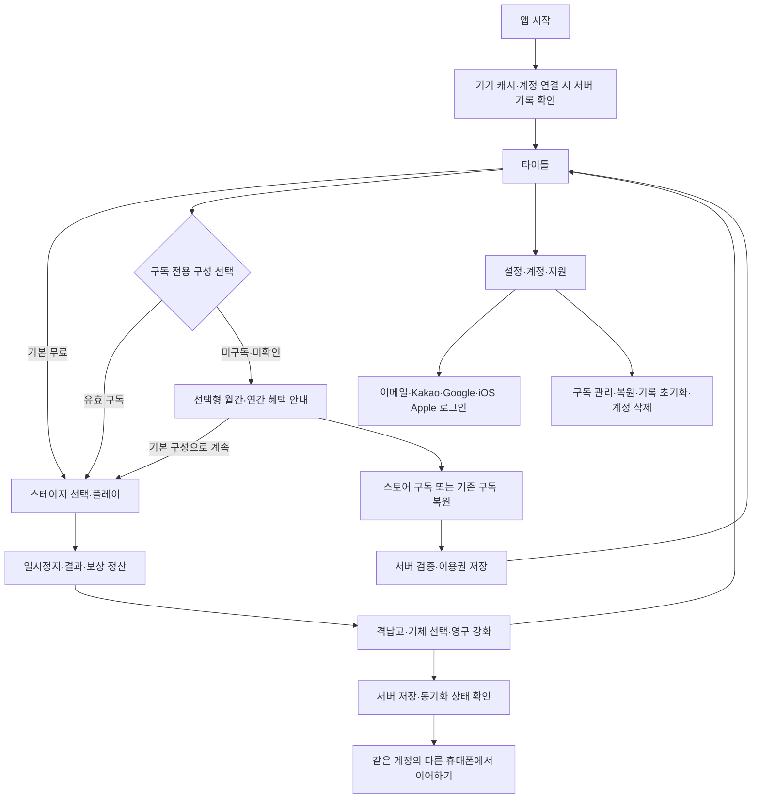

# 게임·화면 설계안

2026-10-29 최신 방향은 **테일윙 · TAILWING의 귀엽고 밝은 미래형 SF**다. [12종 캐릭터·기체·기술 설계](TAILWING-ROSTER-PLAN.md)와 [실제 적용/검사](TAILWING-ROSTER-RESULTS.md)를 우선한다. 무료 토끼/여우/거북이·기본 사격/보호막과 월·연 동일 혜택 구독의 전체 캐릭터/고유 기술을 구분한다. 아래 제2차 세계대전·P-38 외형과 옛 카탈로그 수량/구성안은 변경 전 설계 이력이며 현재 미술 방향이 아니다. 시점·조작·스테이지·기록/식별자·계정·결제 구조는 유지한다.

## 목표와 유료 가치

직장인·대학생이 짧은 휴식 시간에 손쉽게 조작하면서 비행기와 로봇의 전환·적탄 회피·폭탄 사용 타이밍으로 반복 도전하는 싱글 플레이 슈팅을 목표로 한다. 최신 요청으로 기본 플레이·기본 기체/무장·일반 스테이지·진행/점수 기록은 무료이며 추가 기체·스킬·캐릭터·특수 장비/강화 효과를 월간/연간 구독으로 이용한다. 두 구독의 혜택은 같고 가격은 관리자 사용자만 최종 검토 후 스토어 콘솔에서 정한다. 점수 향상·기체 선택·영구 성장·스테이지 숙련이 반복 사용 동기다. 판매량이나 수익은 보장하지 않는다.

제2차 세계대전은 분위기와 기체 참고 배경이며, 로봇 변신은 허구 설정이다. 실제 역사와 허구를 혼동시키는 설명을 하지 않는다. P-38 참고 자료·명칭·각색 이미지의 이용 조건, 앱 작업명의 외부 사용 가능성을 공개 전에 확인한다. 기존 게임의 공식 후속작이라고 표시하지 않는다.

## 첫 출시 제안 (사용자 확정 기능과 구분)

사용자가 요청한 기능은 P-38 기반 기체 조종·로봇 변신·폭탄, 영구 능력치 성장, 기체별 개성, 규칙적인 탄막과 작은 중심 판정이다. 첨부 이미지의 현대화도 포함한다. 아래 첫 출시 분량과 수치는 4단계에서 다듬을 설계 제안이며 이미 승인된 세부 사양으로 표시하지 않는다.

- 세로 스크롤·1인 플레이. 첫 출시는 P-38 기반 화력형과 오리지널 속도형 2종을 제안한다. 광역형·실드형은 뒤의 확장 범위로 나누며, 모든 기체를 첫 버전 완성이라고 표시하지 않는다.
- 3개의 짧은 스테이지와 단계별 적 패턴·보스. 실제 분량·난이도는 플레이 검증 후 확정한다.
- 한 손 드래그 이동·기본 자동 사격을 기본 조작안으로 두고, 변신·폭탄 버튼은 손가락 위치와 겹치지 않게 배치한다.
- 사격/피격/점수·남은 기회·게임 오버·재도전·스테이지 클리어. 확률형 유료 아이템·유료 컨티뉴는 없다.
- 최고 점수·도달 구간·기체·성장·재화는 계정 연결 후 서버에 동기화하고 같은 계정으로 다른 휴대폰에서 이어한다. 음량/진동/조작 설정은 기기에 유지하며 계정 기록 초기화와 기기 캐시 삭제를 구분한다.
- 플레이로 획득한 코인·포인트로 격납고에서 기본 공격력·장갑·스페셜 쿨타임·아이템 자석 범위를 영구 강화한다. 강화 모듈의 적용 효과는 구독 전용이며 저장한 성장 이력은 만료 후에도 보존한다. 성장 상한/코인 비용 곡선은 밸런스 검증 후 확정한다. 실제 돈으로 재화를 팔거나 광고로 보상하지 않는다.
- 스테이지 종료 → 보상 정산 → 격납고 기체 선택/강화 → 재출격의 로그라이트 성장 루프를 포함한다. 절차 생성 맵·런마다 무작위 빌드는 첫 출시 필수가 아니다.
- 대형 보스는 공격 예고와 포대 등 부위별 파괴를 제안한다. 1차 출시는 소수 부위의 명확한 패턴 변화부터 검증하고 상세한 물리 파괴는 확대하지 않는다.
- 기본 플레이는 구독·계정 없이 제공하며 추가 기체·스킬·캐릭터·특수 장비/강화 효과를 사용할 때만 유효 구독을 확인한다. 프리미엄은 구독 기간에 반복 사용하는 장착형 콘텐츠로 구성하며 일회성 재화 지급만을 구독 혜택으로 삼지 않는다. 구독 만료 시 기본 구성으로 전환하고 기존 성장·기록은 보존한다. 현재 기본 화면은 구성안이며 실제 게임은 5단계다.

## 변신과 폭탄의 작은 동작 단위

| 단위 | 설계와 관찰 가능한 완료 기준 |
|---|---|
| 기체 이동 | 화면/안전 영역 밖으로 나가지 않고 드래그 중 입력이 끊겨도 튀지 않음 |
| 사격·충돌 | 탄환 한 발의 피해가 한 번만 반영되고 파괴된 적·탄환이 재활용 풀에서 누적되지 않음 |
| 변신 | plane → transforming → robot → returning 상태. 연출 중 중복 입력을 무시하고 사격/피격 규칙이 명확함 |
| 변신 종료 | 게이지/시간 만료·스테이지 종료·게임 오버 시 일관되게 복귀하고 재시작 시 이전 상태가 남지 않음 |
| 폭탄 | 사용 가능 수량·효과·피해 범위를 UI에 표시. 한 번 누를 때 한 번만 소모하고 적탄 제거/범위 공격 규칙이 재현 가능함 |
| 중단/복귀 | 앱이 백그라운드로 가면 게임·음향 일시정지. 복귀 시 확인 없이 진행되지 않음 |
| 결과·저장 | 클리어/게임 오버 때 점수·최고 기록을 저장하고 강제 종료 후에도 이전 정상 저장본을 읽음 |
| 기기 간 이어하기 | 서버 저장 완료 체크포인트를 같은 UID의 다른 기기에서 불러옴. 동기화 대기/실패/충돌을 완료로 표시하지 않음 |
| 영구 성장 | 보상을 한 번만 정산하고 강화 비용을 원자적으로 차감. 같은 결과 화면 재진입·앱 강제 종료로 재화가 중복 지급되지 않음 |
| 기체 선택 | 속도/탄종/스페셜 차이를 미리 설명하고 선택한 기체의 저장·해금·변신 상태가 다음 출격에 일치함 |
| 탄막 | 규칙적인 패턴·예고·회피 틈을 갖고, 중심 히트박스를 시각적으로 알려 실제 판정과 일치함 |

변신 시간·게이지 획득량·폭탄 수·피격 무적 시간·적 체력·성장 상한·기체별 속도·탄막 밀도·히트박스 크기는 밸런스 변수로 분리한다. 시각 크기와 판정은 독립시키되 작은 판정이 보이지 않는 함정이 되지 않게 한다. 지금 임의의 숫자를 판매 조건이나 확정 기능으로 쓰지 않는다.

## 화면 흐름

스토어 확인/검증 실패·구매 대기·오프라인·복원할 항목 없음·이미 다른 앱 계정과 연결됨을 구별한다. 대기나 오류를 구매 성공으로 표시하거나 반복 구매를 유도하지 않는다.

## 단순한 화면 원칙

- 계정 화면: 흰 배경·검은 제목/기본 버튼·밑줄 입력란, 가입/복구 링크와 하단 소셜 로그인. 본 단계에 별도 참고 이미지는 첨부되지 않았으므로 사용자 텍스트 지침을 기준으로 한다.
- 게임 화면: 적탄/기체/배경의 대비를 우선하고 HUD는 점수·상태·변신·폭탄·일시정지 정도로 제한한다. 가독성·진동/음량 끄기·이펙트 완화·터치 목표 크기를 검토한다.
- 상단 복잡한 메뉴·계정 탭을 게임 중에 상시 두지 않는다. 타이틀의 설정/지원 진입점으로 충분한지 먼저 검증한다.
- 소셜 버튼 전체를 검은색으로 통일하지 않는다. [Google 공식 지침](https://developers.google.com/identity/branding-guidelines), [Kakao 공식 지침](https://developers.kakao.com/docs/ko/kakaologin/design-guide), [Apple 공식 지침](https://developer.apple.com/design/human-interface-guidelines/sign-in-with-apple)에 맞는 버튼·간격·동등한 노출을 사용한다.

## 첫 출시에서 제외 / 이후 검토

첫 출시에서 메모 기능·멀티플레이·온라인 순위·채팅·SNS 공유·AI 기능·광고·유료 뽑기·재화 판매는 제외한다. 최신 요청의 기본 무료/월간·연간 구독 전용 콘텐츠와 계정 서버 저장를 반영한다. 지금 화면의 기체 3·스킬 3·캐릭터 2·장비 3개는 비교용 구성안으로 최종 출시 수량은 미정이다. 이후 콘텐츠·패턴·변신 연출·난이도·접근성·컨트롤러 지원은 검증·운영 예산에 맞춰 정한다. 상세 시각 방향은 VISUAL-UPGRADE.md를 따른다.
